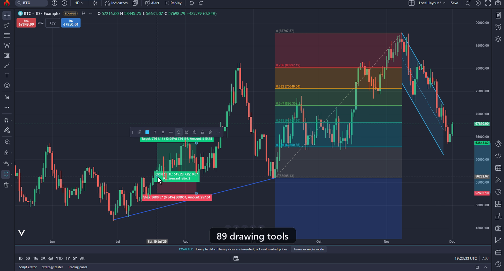
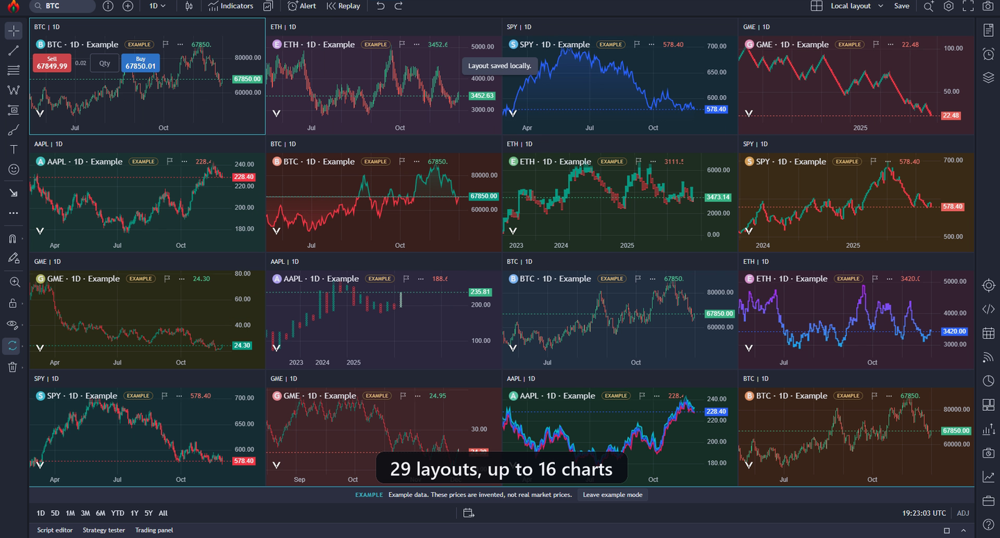
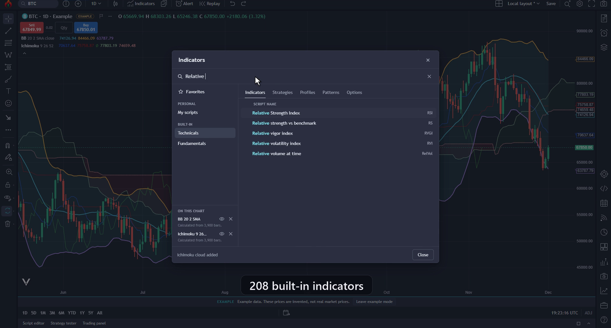

# OpenCandle

OpenCandle is a free, source-available desktop charting app for Windows. It charts market data, runs indicators and your own scripts, tests strategies, and lets you practise with paper trading, all on your own computer.

- **Bring your own data.** OpenCandle ships with practice data and connects to free public sources. Real-time US stocks use your own free Alpaca key. You can also import your own files.
- **No account.** There is nothing to sign up for and no login.
- **No telemetry.** OpenCandle does not collect usage data or send anything home. Network requests happen only for data sources you turn on or open.
- **Local first.** Your workspace, drawings, scripts, alerts and settings are saved in your Windows profile folder.

Website: https://getopencandle.com

> OpenCandle 0.8.0 is the first public release. Expect rough edges, and please report what you find.

## Screenshots







_Screenshots use the built-in example data, not real market prices._

## Features

**Charts**
- 22 chart types, including candles, Heikin Ashi, Renko, Kagi, point and figure, line break, range bars, volume footprint, TPO and session volume profile.
- Multi-chart layouts: 29 layouts with up to 16 charts, layout tabs, a layout library, and six sync switches (symbol, interval, crosshair, time, date range, drawings).
- Symbol search, compare and overlay symbols, standard and custom intervals, go to date, data window, table view and chart image export.

**Indicators and drawings**
- 211 built-in indicators, including 5 volume profiles and 62 chart and candlestick patterns, each with its own settings per instance.
- 89 drawing tools (lines, channels, pitchforks, Fibonacci and Gann tools, patterns, shapes, text, measurement and more), with an object tree, templates, favorites, lock and hide, magnet snapping, and undo/redo.

**Analysis and practice**
- Bar replay: step and play through history. Calculations never see the hidden future bars.
- Alerts on price, drawings and indicators, with a manager, trigger history and export.
- Watchlists with import and export.
- Strategy tester with 23 built-in strategies, performance summary, report chart and saved reports.
- Paper trading with virtual market, limit, stop and stop-limit orders and a DOM pane. Virtual money only; OpenCandle never places real orders.

**Scripting**
- CandleScript, OpenCandle's own scripting language for indicators, strategies and alert conditions. It runs in a restricted, deterministic sandbox and has an editor with completion, diagnostics, a library and logs. See [docs/candlescript.md](docs/candlescript.md).
- Pine Script import: the importer translates common Pine v5/v6 indicators and simple strategies into CandleScript for you to review and run. It does not run Pine itself, and some constructs are left as marked TODOs. See [docs/pine-import.md](docs/pine-import.md).

**More**
- Screener over loaded datasets, fundamentals from SEC EDGAR, SEC filings, market views (breadth, macro maps, yield curves from FRED, seasonals), heatmap, calendar and news imports, and a portfolio view.
- Two built-in themes, **OpenCandle Medium Dark** (default) and **OpenCandle Dark**, with full chart appearance settings.

## Data sources: what you need

OpenCandle starts with no account and no key. Open **Data sources** from the main menu to see this table with the status of each source.

| What you want | Minimum you need | How to get it |
| --- | --- | --- |
| Practice charts | Nothing. Built in. | Open GME, SPY or another built-in symbol. These prices are invented, not real. |
| Real-time US stocks and ETFs | A free Alpaca account and its API key | Sign up at alpaca.markets (a free paper trading account is enough), create an API key in the dashboard, and paste the Key ID and Secret in Data sources. Free plan: live prices from the IEX exchange, up to 30 symbols at once. Live prices from all exchanges need a paid Alpaca market data plan. |
| US stock history (daily and intraday) | The same free Alpaca key | All-exchange history with splits and dividends; on the free plan the newest 15 minutes come from IEX. |
| Crypto (BTC-USD, ETH-USD, SOL-USD) | Nothing. No account or key. | Turn on live crypto data in Data sources (Coinbase public market data). |
| Economic data and rates | Nothing. No account or key. | Type `FRED:` and a series id (for example `FRED:DGS10`) or open Markets. Each series downloads from the St. Louis Fed only when you open it. |
| Company fundamentals and SEC filings | Nothing. No account or key. | Open Fundamentals or SEC filings; data comes from the SEC's public EDGAR service when you ask. |
| Your own data (any market) | A CSV or JSON file of bars | Import a file with columns time (or date), open, high, low, close, volume; up to 20 MB and 100,000 rows. |
| Options, futures, forex, live news | Not available from a built-in source | Import your own files. |

You use your own accounts and keys, and each provider's terms apply to the data you connect. Data from Alpaca, Coinbase and FRED is for personal viewing and is not exported. Details: [docs/data-sources.md](docs/data-sources.md).

## Install

Download the latest Windows build from the [releases page](https://github.com/getopencandle/opencandle/releases/latest) or https://getopencandle.com. Extract the whole ZIP and run `OpenCandle.exe`. Builds are not code-signed yet, so Windows SmartScreen may ask you to confirm.

## Build and run from source

Requirements:
- Windows 10 or 11, x64. Other platforms are not supported yet.
- Node.js 24 LTS (22.12 or later works) and npm.
- Python 3 (3.12 tested), only for packaging a portable ZIP.

```powershell
git clone https://github.com/getopencandle/opencandle.git
cd opencandle
npm ci            # installs dependencies and applies the Vela compatibility patch
npm run build     # typecheck and build the renderer into dist/
npm start         # start the desktop app from source (uses dist/)
```

Other commands:

| Command | What it does |
| --- | --- |
| `npm run dev` | Starts the Vite dev server at http://127.0.0.1:5173 in a browser. Desktop-only features (data sources, files, keys) show "Needs the desktop app". |
| `npm test` | Runs the full Vitest suite. |
| `npm test -- tests/domain/indicator-catalog-oracles.test.ts` | Runs one test file or folder. |
| `npm run test:watch` | Watch mode. |
| `npm run package` | Builds and creates a portable Windows ZIP under `out/`. |

The full suite is large. To run it in eight shards with one worker each:

```powershell
$env:NODE_OPTIONS = "--max-old-space-size=6144"
1..8 | ForEach-Object { npx vitest run --no-fs-module-cache --no-cache --maxWorkers=1 --shard=$_/8 }
```

More: [docs/testing.md](docs/testing.md) and [docs/building-and-packaging.md](docs/building-and-packaging.md).

## Project layout

| Path | Contents |
| --- | --- |
| `src/chart/` | Chart engine integration (Vela), chart types, scales, drawings, layouts, image export |
| `src/domain/` | Indicators, patterns, strategies, alerts, replay, paper trading, data sources, Pine importer |
| `src/ui/` | React user interface: dialogs, panels, menus, themes, icons |
| `src/analysis-news/`, `src/fundamentals/`, `src/market-views/`, `src/portfolio/`, `src/strategy-report/`, `src/watchlists/`, `src/vwap/` | Feature areas |
| `electron/` | Main process: windows, storage, native dialogs, data providers, script sandbox, preload bridge |
| `tests/` | Vitest suites, organised like `src/` |
| `examples/` | Synthetic example files for imports |
| `scripts/` | Packaging and build helpers |
| `tools/iex-hist/` | Optional Python tool that builds 1-minute bars from free IEX historical data |
| `docs/` | User and developer documentation |

See [docs/architecture.md](docs/architecture.md) for how the pieces fit together.

## Documentation

- [CandleScript guide](docs/candlescript.md)
- [Pine Script import](docs/pine-import.md)
- [Data sources](docs/data-sources.md)
- [Architecture](docs/architecture.md)
- [Building and packaging](docs/building-and-packaging.md)
- [Testing](docs/testing.md)
- [Vela modifications](docs/vela-modification.md)

## Contributing

Bugs and feature ideas: [GitHub Issues](https://github.com/getopencandle/opencandle/issues). Questions: [GitHub Discussions](https://github.com/getopencandle/opencandle/discussions).

Contributions are welcome. Please read [CONTRIBUTING.md](CONTRIBUTING.md) and the [Code of Conduct](CODE_OF_CONDUCT.md). To report a security problem, see [SECURITY.md](SECURITY.md).

## Licence and trademarks

OpenCandle is licensed under the [PolyForm Noncommercial License 1.0.0](LICENSE): free to use, change and share, but not for sale or commercial use. For a commercial licence, ask in [GitHub Discussions](https://github.com/getopencandle/opencandle/discussions). Third-party components keep their own licences; see [NOTICE](NOTICE) and [THIRD_PARTY.md](THIRD_PARTY.md). Charts are rendered with [Vela](https://velacharts.dev) by LuxAlgo, whose attribution mark stays visible on every chart.

The licence does not cover the OpenCandle name or logo. Forks and redistributions should use their own name and logo and must not imply endorsement.

OpenCandle is an independent project. It is not affiliated with or endorsed by TradingView, Alpaca, Coinbase, the SEC, the Federal Reserve Bank of St. Louis or IEX. TradingView and Pine Script are trademarks of TradingView, Inc.

OpenCandle is provided as is, without warranty, and is not financial advice. Paper trading is simulated with virtual money, and built-in practice data is invented.
